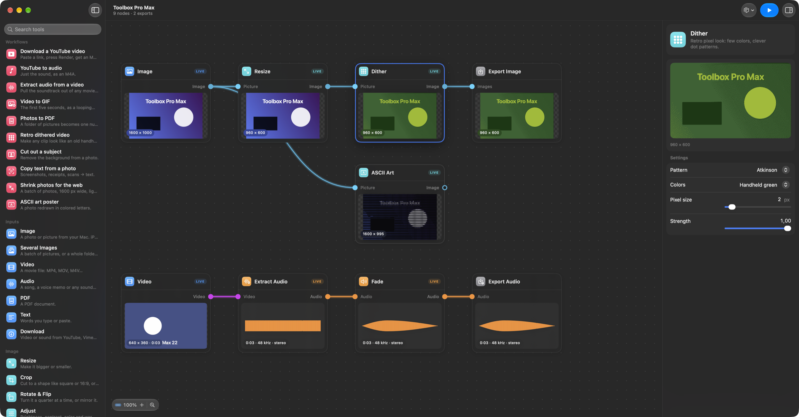

# Toolbox Pro Max

A native Mac app where you drop in photos, videos, sound or PDFs and wire tools together as a node graph.
Every step shows a live preview; ⌘R renders the results to files.



## Where it comes from

It started as a friendly joke. A friend of mine, Cojo, built [Toolbox](https://github.com/MinuneIonel/Utilities),
an Electron app that wires image, video, audio and PDF tools together as a node graph. The idea was to make
"the same toy, but packaged the Apple way": a native SwiftUI app that looks and feels like it belongs on a Mac.
The idea is his; none of his code is used. Toolbox Pro Max was written from scratch.

**How it was made:** in one session with [Claude Code](https://claude.com/claude-code), Anthropic's AI
coding agent. The idea, the choices and the testing on my Mac are mine; Claude wrote the code. I'm saying so
plainly because it's true and because it's part of what makes the project interesting.

## Download

Get `Toolbox-Pro-Max-0.1.0.dmg` from [Releases](../../releases).

- **Needs** a Mac with Apple Silicon (M1 or newer) and **macOS 26 Tahoe** or newer.
- The app isn't signed with a paid Apple certificate, so macOS asks once. Drag Toolbox Pro Max into
  Applications and open it. When macOS says it can't check the app, open
  **System Settings → Privacy & Security**, scroll down and click **Open Anyway**.

## What it can do (v0.1)

| | Nodes |
| --- | --- |
| **Inputs** | Image, Several Images (files or a folder), Video, Audio, PDF, Text, Download (YouTube, Vimeo, SoundCloud… via yt-dlp) |
| **Image** | Resize, Crop, Rotate & Flip, Adjust, Dither (retro palettes), ASCII Art, Lift Subject (removes the background, on device) |
| **Video** | Trim Video, Grab Frame. Every Image node also works on a video, frame by frame |
| **Audio** | Extract Audio, Trim Audio, Fade, Normalize, Mix to Mono |
| **PDF** | Merge, Pick Pages, Watermark, Page Numbers, Images to PDF, PDF to Images |
| **Text** | Read Text (Live Text on photos and scanned PDFs), ASCII to Text |
| **Export** | Image (JPEG, HEIC, PNG, TIFF), Video (H.264, HEVC, ProRes 422, GIF, or no re-encode), Audio (M4A, Apple Lossless, WAV, AIFF), PDF (optional password, compression), Text |

Also: 10 ready-made workflows, undo/redo, autosave, light and dark mode.

## About the size

The disk image is **2.3 MB**. Toolbox 0.3.0's Mac download is 164 MB. That's not because this one is
cleverer: Toolbox also runs on Windows and Linux, so it carries its own browser engine (Electron) and its own
ffmpeg. Toolbox Pro Max only runs on recent Macs and uses what macOS already ships: Core Image, AVFoundation,
Vision and PDFKit. Different trade-offs, and Toolbox still does things this one doesn't (see below).

## What's tested, and what isn't

Tested, on one Mac (Apple Silicon, macOS 26):
- A built-in self-test runs every node on generated media (photo, video, sound, PDF) and writes each export
  format: 25 chains, all passing. It includes a real YouTube download, video and sound-only.
- By hand: building graphs, connecting and moving nodes, zoom, live previews, the inspector, Render.

Not tested: Intel Macs or macOS older than 26 (neither is supported), other people's Macs, very long or very
large files, and a wide range of real-world formats.

## Known limitations

- No WebP, AVIF or MP3 export, no webcam input, no Romanian diacritics tool (Toolbox has all of these).
- YouTube downloads go up to 1080p H.264. VP9/AV1-only formats aren't used.
- The first accurate text recognition after each launch takes about 25 seconds while macOS loads its
  model. Live previews use the fast model in the meantime.
- GIF export stops at 900 frames.
- No automatic updates yet.
- The Download node fetches yt-dlp from its GitHub releases the first time, checks it against the published
  SHA-256 and refreshes it weekly. Only download things you have the right to.

## Two editions

The same code builds the **full edition** (this page's releases, free, with the YouTube Download node) and a
**Mac App Store edition** that is sandboxed and leaves out downloading, as the App Store requires.
See [AppStore/README.md](AppStore/README.md).

## Build from source

Needs Xcode 26 or newer.

```sh
./scripts/build-app.sh   # → build/Toolbox Pro Max.app and build/Toolbox-Pro-Max-<version>.dmg
swift run                # quick run from source (no icon)
```

Self-test, which makes sample media, runs every node and writes the results:

```sh
.build/debug/ToolboxProMax --selftest /tmp/tpm-test
.build/debug/ToolboxProMax --selftest /tmp/tpm-test --download "https://www.youtube.com/watch?v=jNQXAC9IVRw"
```

## How it fits together

- `Model/Catalog.swift` defines every node: its ports, its settings and what it does.
- `Engine/` does the processing (`ImageOps`, `Dither`, `ASCII`, `VisionOps`, `VideoOps`, `AudioOps`, `PDFOps`, `Downloader`).
- `Engine/Evaluator.swift` runs the graph and caches each node's result by a fingerprint of its settings and
  everything upstream, so moving a slider only recomputes what comes after it.
- Image effects are closures `(CIImage, scale) -> CIImage`. They're applied once to a still, or plugged into an
  `AVVideoComposition` for video. `scale` keeps pixel-sized effects identical between preview and render.
- YouTube serves picture and sound as separate fragmented MP4s whose timestamps AVFoundation reads at twice
  their length. Normally ffmpeg fixes that up. Here they're joined without re-encoding, and the picture's
  timing is recomputed from its frame count.

## License

[MIT](LICENSE): use it, change it, share it, just keep the copyright notice.
yt-dlp, which the Download node fetches on first use, is a separate project under its own license (Unlicense).
